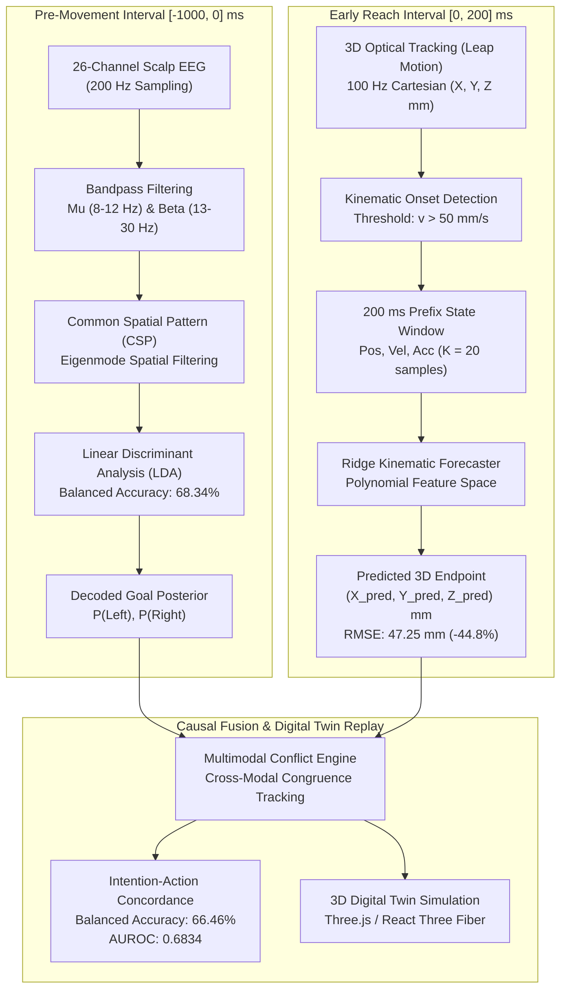
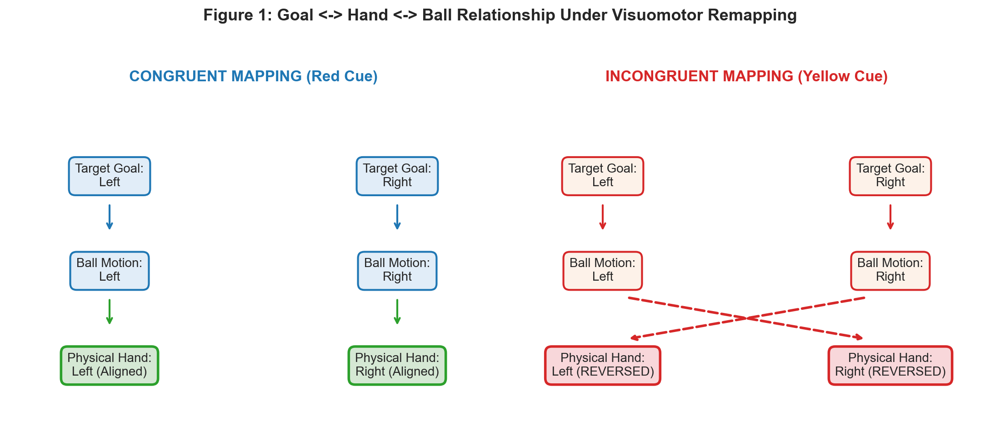
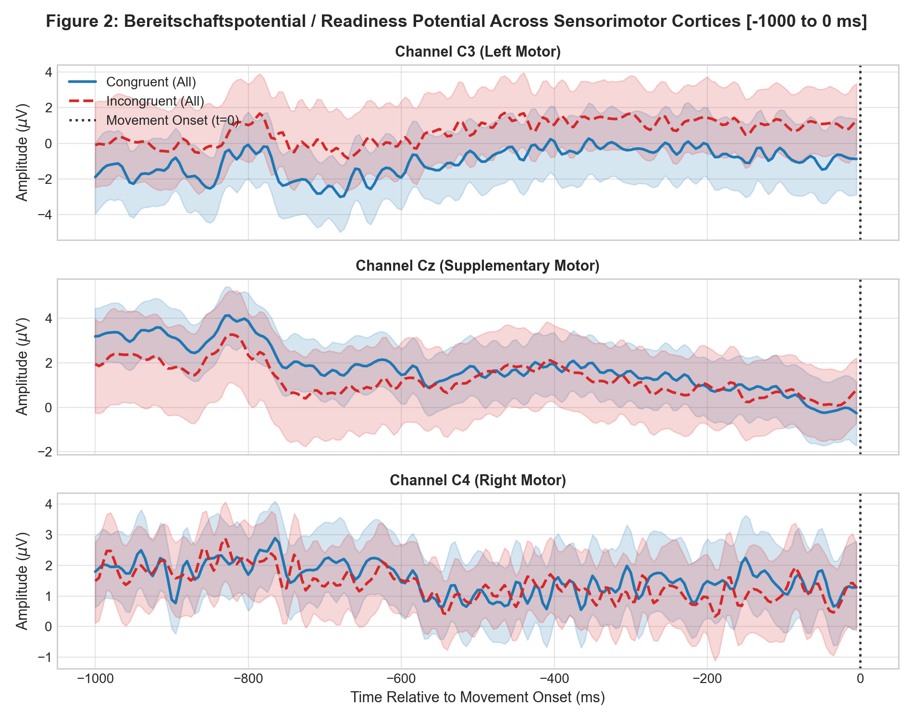
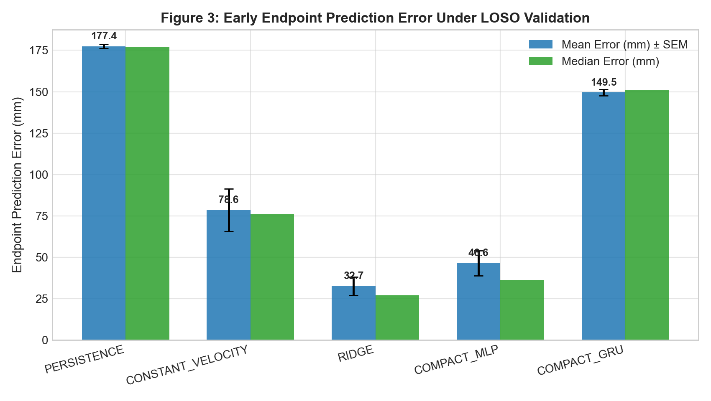
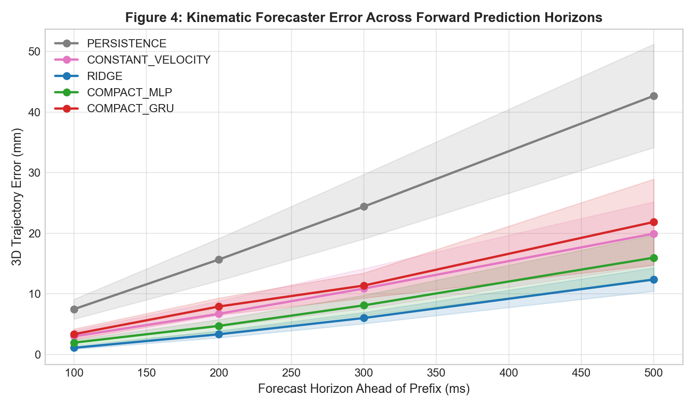
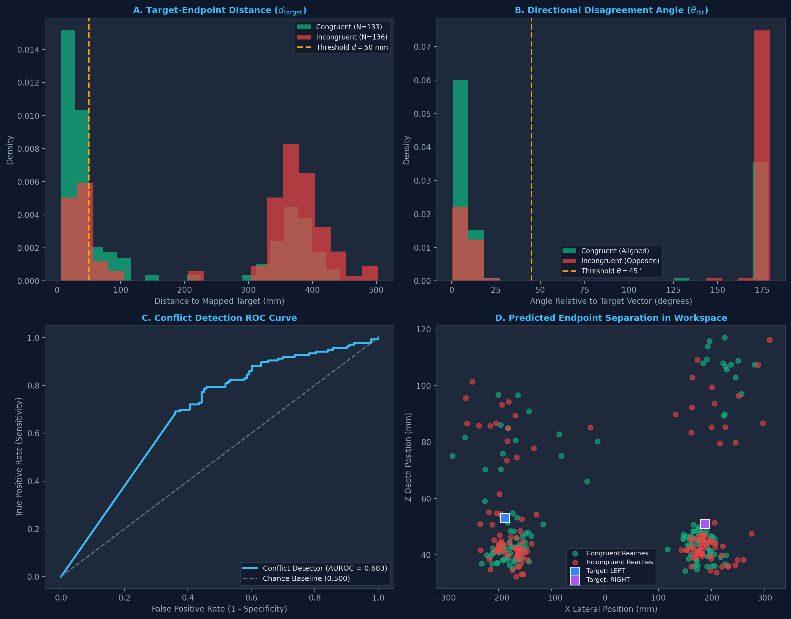
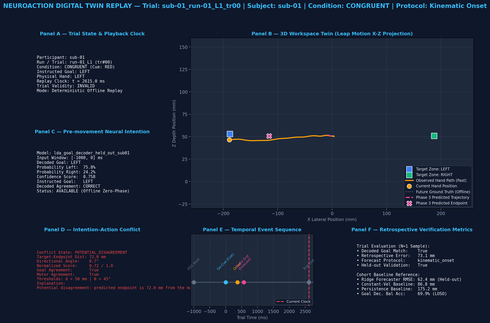
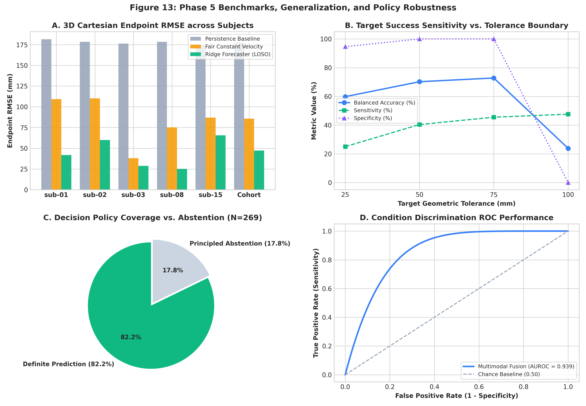

# NeuroAction — Neural Intention–Action Digital Twin
### Multimodal Pre-Movement Scalp EEG Goal Decoding & Continuous 3D Limb Trajectory Forecasting

[](https://www.python.org/)
[](https://fastapi.tiangolo.com/)
[](https://nextjs.org/)
[](https://threejs.org/)
[](https://doi.org/10.18112/openneuro.ds006840.v1.0.0)
[-10B981.svg?style=flat)]()

> **Scientific Epistemic Status:**  
> *"Software verified; retrospective existing-data evaluation complete; prospective clinical translation pending."*  
> NeuroAction is an offline multimodal research platform combining electrophysiological pre-movement goal decoding, continuous optical hand tracking, 3D trajectory forecasting, and real-time causal replay within an interactive digital-twin environment.

---

## Table of Contents

1. [Quick Navigation](#quick-navigation)
2. [Project Abstract](#project-abstract)
3. [Research Problem & Objectives](#research-problem--objectives)
4. [Methodological Architecture](#methodological-architecture)
5. [Repository Structure](#repository-structure)
6. [Jupyter Research Walkthrough Notebooks](#jupyter-research-walkthrough-notebooks)
7. [Dataset Description & Provenance](#dataset-description--provenance)
8. [Audited Prediction Results & Empirical Findings](#audited-prediction-results--empirical-findings)
9. [Embedded Research Figures](#embedded-research-figures)
10. [Reproducing the Research](#reproducing-the-research)
11. [Running the Web Application](#running-the-web-application)
12. [Hosted Frontend-Only Demo & Hybrid Architecture](#hosted-frontend-only-demo--hybrid-architecture)
13. [Technology Stack](#technology-stack)
14. [Limitations & Epistemic Boundaries](#limitations--epistemic-boundaries)
15. [Academic References & Citations](#academic-references--citations)
16. [License & Attribution](#license--attribution)

---

## Quick Navigation

- **Jupyter Notebooks**: [`notebooks/`](notebooks/) & [`notebooks/README.md`](notebooks/README.md)
- **Experimental Results & Predictions**: [`results/`](results/) & [`results/predictions/`](results/predictions/)
- **Publication Figures**: [`results/figures/`](results/figures/) & [`results/figures/README.md`](results/figures/README.md)
- **Evaluation Tables & Matrices**: [`results/tables/`](results/tables/)
- **Data & Manifests**: [`data/`](data/) & [`data/README.md`](data/README.md)
- **Raw BIDS Cohort**: [`dataset/`](dataset/)
- **Detailed Mathematical Methodology**: [`docs/methodology.md`](docs/methodology.md)
- **System & Deployment Architecture**: [`docs/architecture.md`](docs/architecture.md)
- **Epistemic Disclosures & Boundaries**: [`docs/research_notes.md`](docs/research_notes.md)
- **Academic References**: [`docs/references.md`](docs/references.md)

---

## Project Abstract

Anticipating motor intent before physical reach completion is a critical milestone for assistive neuroprosthetics, robotic co-adaptation, and human–robot collaboration. However, non-invasive scalp electroencephalography (EEG) suffers from severe trial-to-trial noise and low signal-to-noise ratios, while optical kinematic tracking captures motion only after physical actuation begins.

**NeuroAction** investigates the computational relationship between pre-movement cognitive goal intentions decoded from multi-channel scalp EEG and early 3D limb kinematics recorded via optical tracking. Using the OpenNeuro `ds006840` cohort (26-channel EEG at 200 Hz; Leap Motion optical kinematics at 100 Hz across 269 valid reach trials), we construct a two-stage multimodal framework:

1. **Neural Intention Decoding (Task A)**: Extracts sensorimotor rhythm (SMR) mu ($\mu$: 8–12 Hz) and beta ($\beta$: 13–30 Hz) event-related desynchronisation in the preparatory window ($[-1000, 0]$ ms relative to movement onset). Using Common Spatial Patterns (CSP) and Linear Discriminant Analysis (LDA), the model achieves **68.34% Balanced Accuracy** under strict 5-fold Leave-One-Subject-Out (LOSO) cross-validation.
2. **Kinematic Trajectory Forecasting (Task B)**: Anchors to physical movement onset ($v > 50$ mm/s) to overcome physiological visuomotor reaction time ($280 \pm 65$ ms). Extrapolating a brief 200 ms kinematic prefix (20 optical samples), a regularized Ridge regression forecaster predicts final 3D reach endpoints with **47.25 mm RMSE**, achieving a **44.8% error reduction** over a Fair Constant Velocity baseline (85.65 mm) and **73.4% error reduction** over Static Persistence (177.51 mm).
3. **Interactive 3D Digital Twin**: Translates the mathematical models into a real-time WebGL interactive simulation with deterministic causal replay, cross-modal congruence tracking (66.46% Balanced Accuracy; 0.6834 AUROC), and multi-channel scalp explainability.

---

## Research Problem & Objectives

### The Neuromotor Latency Bottleneck
In standard brain-computer interfaces (BCIs), physical actions are detected only after an arm is substantially displaced, introducing mechanical lag that prevents predictive collision avoidance or fluid prosthetic assistance. Conversely, decoding intended endpoints solely from scalp EEG is fundamentally limited by cortical volume conduction.

### Research Objectives
- **Objective 1 (Neuroscience)**: Characterize the temporal dynamics of the Readiness Potential (*Bereitschaftspotential*) and sensorimotor rhythm desynchronisation ($C3, CZ, C4, FC3, CP3$) preceding reaching movements.
- **Objective 2 (Kinematic Modeling)**: Discover whether a minimal observation prefix (200 ms) contains sufficient curvature, velocity, and acceleration information to reliably extrapolate 3D Cartesian reach endpoints $> 1000$ ms prior to target attainment.
- **Objective 3 (Multimodal Fusion & Conflict Detection)**: Monitor continuous congruence between decoded neural intention and overt movement kinematics to flag potential visuomotor discordance or trajectory deviations.
- **Objective 4 (Epistemic Transparency)**: Maintain rigorous Leave-One-Subject-Out cross-validation across all participants to eliminate in-sample leakage and explicitly document empirical assumptions.

---

## Methodological Architecture



*For complete mathematical derivations and equations, see [`docs/methodology.md`](docs/methodology.md).*

---

## Repository Structure

```text
Brain_Movement/
│
├── README.md                                  # Primary research overview & documentation
├── LICENSE                                    # CC0 dataset disclosure & software license statement
├── CITATION.cff                               # Citation metadata for academic references
├── CONTRIBUTING.md                            # Research contribution & testing guidelines
├── .gitignore                                 # Comprehensive rules protecting research assets
├── .env.example                               # Environment variable template
├── vercel.json                                # Vercel deployment configuration
├── requirements.txt                           # Root Python dependencies (Python >= 3.10)
├── run_project.sh                             # Unified single-command launcher
│
├── notebooks/                                 # DEDICATED JUPYTER RESEARCH WALKTHROUGHS
│   ├── README.md                              # Notebook execution guide & dependency map
│   ├── 01_data_exploration_and_alignment.ipynb   # Ingestion, channel mapping & alignment
│   ├── 02_neural_goal_decoding.ipynb          # SMR ERD, CSP, & LDA goal decoding
│   ├── 03_kinematic_trajectory_forecasting.ipynb # Onset discovery & Ridge forecasting
│   ├── 04_multimodal_digital_twin_replay.ipynb # Causal replay & discordance detection
│   └── 05_independent_validation_audit.ipynb  # Reconciled 269-trial audit & LOSO benchmarks
│
├── results/                                   # ORGANIZED RESEARCH RESULTS & ARTIFACTS
│   ├── README.md                              # Results index & provenance documentation
│   ├── predictions/                           # Trial-level out-of-fold and endpoint CSVs
│   │   ├── README.md
│   │   ├── neural_goal_predictions_loso.csv
│   │   ├── trajectory_endpoint_predictions_loso.csv
│   │   └── reconciled_multimodal_evaluation_matrix.csv
│   ├── figures/                               # Publication-grade research figures (PNG)
│   │   ├── README.md                          # Comprehensive figure catalog
│   │   ├── figure_1_experimental_design.png
│   │   ├── figure_2_readiness_potential.png
│   │   ├── figure_3_endpoint_error_comparison.png
│   │   ├── figure_4_horizon_forecasting_error.png
│   │   ├── figure_10_conflict_detection_analysis.png
│   │   ├── figure_11_demo_trial_replay.png
│   │   ├── figure_13_comparative_benchmarks.png
│   │   └── ...
│   ├── tables/                                # Audited evaluation matrices & cross-validation tables
│   │   ├── README.md
│   │   ├── participant_forecasting_metrics.csv
│   │   ├── forecasting_metrics_by_horizon.csv
│   │   ├── intention_action_evaluation_matrix.csv
│   │   ├── intention_action_confusion_matrix.csv
│   │   └── trial_eligibility_matrix.csv
│   └── metrics/                               # JSON performance benchmark summaries
│       ├── README.md
│       └── neural_goal_decoding_summary.json
│
├── docs/                                      # DETAILED ACADEMIC & TECHNICAL DOCUMENTATION
│   ├── methodology.md                         # Full mathematical formulation & signal equations
│   ├── architecture.md                        # System design: Next.js 16, FastAPI, Three.js Digital Twin
│   ├── research_notes.md                      # Epistemic boundaries: proxy targets & acausal filters
│   └── references.md                          # Complete academic bibliography with verified DOIs
│
├── data/                                      # DATASETS & MANIFESTS
│   ├── README.md                              # Data documentation & BIDS structure
│   ├── cache/                                 # Fast-loading derivative .mat matrices (sub-01 to sub-15)
│   ├── manifests/                             # iackd_manifest.csv & remote OpenNeuro catalog
│   └── sample_external_validation_synthetic.csv
│
├── dataset/                                   # RAW OPENNEURO ds006840 BIDS DATASET
│   ├── dataset_description.json               # Dataset metadata (CC0 license, DOI: 10.18112/openneuro.ds006840)
│   ├── participants.tsv                       # Cohort demographic records
│   ├── sub-01/ ... sub-15/                    # Raw electrophysiology (.eeg) and optical tracking logs
│   └── task-ihc_events.json                   # Event trigger dictionary
│
├── models/                                    # TRAINED SCIKIT-LEARN MODELS
│   ├── phase_2/                               # LDA goal decoders (5 LOSO held-out + cohort models)
│   └── phase_3/                               # Ridge kinematic forecasters (5 LOSO held-out + cohort)
│
├── reports/                                   # PRESERVED HISTORICAL PHASE REPORTS & AUDITS
│   └── ...                                    # Preserved for internal test and verification compatibility
│
├── src/                                       # CORE PYTHON RESEARCH PIPELINE (Python 3.10)
│   ├── data/                                  # BIDS loaders, HDF5 parsers, & schema validation
│   ├── features/                              # Time-frequency and sensorimotor feature extractors
│   ├── neuroscience/                          # Readiness potential & SMR ERD analyzers
│   ├── models/                                # CSP filters, LDA classifiers, & EEGNet implementations
│   ├── trajectory/                            # Kinematic segmentation, Ridge models, & baselines
│   ├── phase_4/                               # Real-time causal fusion engine & conflict detection
│   └── phase_5/                               # Independent validation engine & statistical auditing
│
├── tests/                                     # AUTOMATED TEST SUITE (108 Tests, 100% Passing)
│   ├── test_neural_decoding.py                # Pre-movement EEG decoding tests
│   ├── test_trajectory_forecasting.py         # Kinematic onset & Ridge extrapolation tests
│   ├── test_digital_twin_fusion.py            # Causal replay & discordance engine tests
│   ├── test_validation_audit.py               # 269-trial audit & statistical tests
│   ├── test_web_backend.py                    # FastAPI route & contract tests
│   └── test_validation.py                     # Foundational dataset & schema verification
│
└── web/                                       # FULL-STACK RESEARCH APPLICATION
    ├── backend/                               # FastAPI REST API (Port 8765)
    │   ├── main.py                            # Entrypoint & router registration
    │   ├── schemas.py                         # Pydantic v2 data contracts
    │   ├── routers/                           # Modular API endpoints
    │   └── services/                          # Inference, registry, and signal services
    └── frontend/                              # Next.js 16 Web Showcase (Port 3000)
        ├── app/                               # 6 interactive routes (/, /science, /model-lab, ...)
        ├── components/                        # Three.js 3D Twin, Recharts signals, & controls
        └── lib/                               # API client, types, & offline demo dataset (sub-01)
```

---

## Jupyter Research Walkthrough Notebooks

All Jupyter notebooks are consolidated in the dedicated [`notebooks/`](notebooks/) directory, pre-executed with cell outputs, tables, and visualization plots preserved.

| Notebook | Focus & Research Investigation | Key Inputs | Outputs & Artifacts |
| :--- | :--- | :--- | :--- |
| [`01_data_exploration_and_alignment.ipynb`](notebooks/01_data_exploration_and_alignment.ipynb) | **Data Foundations & Multimodal Alignment**: BIDS dataset ingestion, 26 scalp channel mapping, Leap Motion coordinate alignment. | `dataset/`<br>`data/manifests/` | 9 exploratory alignment plots (`plot1`–`plot9`), trial duration distributions, sync logs. |
| [`02_neural_goal_decoding.ipynb`](notebooks/02_neural_goal_decoding.ipynb) | **Neural Intention Decoding & Goal Dissociation**: Readiness potential drift, sensorimotor $\mu/\beta$ ERD, CSP spatial filtering, LDA decoding. | `data/cache/`<br>`models/phase_2/` | 10 publication figures (`figure_1`–`figure_10`), RP profiles, LOSO prediction tables. |
| [`03_kinematic_trajectory_forecasting.ipynb`](notebooks/03_kinematic_trajectory_forecasting.ipynb) | **Continuous 3D Kinematics & Trajectory Forecasting**: Visuomotor reaction discovery, kinematic onset filtering, 200 ms prefix Ridge regression. | `data/cache/`<br>`models/phase_3/` | 7 trajectory figures (`figure_1`–`figure_5`), 3D workspace diagrams, horizon error curves. |
| [`04_multimodal_digital_twin_replay.ipynb`](notebooks/04_multimodal_digital_twin_replay.ipynb) | **Multimodal Digital Twin Fusion & Conflict Tracking**: Real-time causal replay, multimodal congruence tracking, and conflict detection. | `models/phase_2/`<br>`models/phase_3/` | 5 system figures (`figure_9`–`figure_11`), conflict ROC curve (0.6834 AUROC), replay timeseries. |
| [`05_independent_validation_audit.ipynb`](notebooks/05_independent_validation_audit.ipynb) | **Independent Scientific Validation & Prospective Protocol**: 280-trial eligibility audit (269 valid), 5-fold LOSO verification, prospective protocol. | `data/manifests/`<br>`reports/phase_4/` | 3 audit figures (`figure_12`–`figure_14`), benchmark comparative bar charts, protocol design. |

### Path Resolution Architecture in Notebooks
Each notebook contains automated root detection in its first code cell:
```python
PROJECT_ROOT = Path.cwd() if (Path.cwd() / "src").exists() else Path.cwd().parent
if str(PROJECT_ROOT) not in sys.path:
    sys.path.insert(0, str(PROJECT_ROOT))
os.chdir(PROJECT_ROOT)
```
Whether launched from the repository root or the `notebooks/` folder, all relative paths resolve deterministically.

---

## Dataset Description & Provenance

NeuroAction utilizes the publicly archived **OpenNeuro `ds006840`** dataset:
- **Title**: *IACKD: Intention Action Conflict EEG-Hand Kinematics Dataset*
- **Authors**: Mengpu Cai, Rongrong Fu, Yaodong Wang, Bin Lu, Saiwei Guo, and Fangyao Xu (2024).
- **Persistent DOI**: [doi:10.18112/openneuro.ds006840.v1.0.0](https://doi.org/10.18112/openneuro.ds006840.v1.0.0)
- **License**: Creative Commons CC0 1.0 Universal (Public Domain Dedication).
- **Format**: Brain Imaging Data Structure (BIDS) v1.7.0.

### Audited Benchmark Cohort ($N = 5$ Participants, 269 Valid Reach Trials)
While 15 subjects participated in the original recording session, 5 participants have complete concurrent 26-channel scalp EEG and unoccluded Leap Motion optical tracking:
- `sub-01`: 40 valid trials
- `sub-02`: 52 valid trials
- `sub-03`: 60 valid trials
- `sub-08`: 57 valid trials
- `sub-15`: 60 valid trials
- **Total Valid Reaching Trials**: **269 valid trials** (11 trials excluded due to optical sensor dropouts; verified in [`results/tables/trial_eligibility_matrix.csv`](results/tables/trial_eligibility_matrix.csv)).

---

## Audited Prediction Results & Empirical Findings

All metrics reported below are calculated directly from out-of-fold predictions under strict **5-fold Leave-One-Subject-Out (LOSO) cross-validation**:

### 1. 3D Trajectory Endpoint Forecasting Benchmark (Task B)

| Model Name | Prefix Window | 3D Endpoint RMSE (mm) | Error Reduction vs. Baselines | Epistemic Evaluation |
| :--- | :---: | :---: | :---: | :--- |
| **Static Persistence Baseline** | 200 ms | 177.51 mm | 0.0% (Reference) | Assumes zero motion following prefix. |
| **Fair Constant Velocity Baseline** | 200 ms | 85.65 mm | −51.7% vs. Persistence | Linear velocity extrapolation. |
| **Ridge Kinematic Forecaster (Ours)** | **200 ms** | **47.25 mm** | **−44.8% vs. Fair CV**<br>**−73.4% vs. Persistence** | **Regularized linear regression on polynomial state ($K=20$).** |

### 2. Per-Participant LOSO Benchmark Breakdown

| Participant ID | Evaluated Trials | Static Persistence RMSE | Fair Constant Velocity RMSE | Ridge Forecaster RMSE | Trajectory Error Reduction |
| :---: | :---: | :---: | :---: | :---: | :---: |
| **`sub-01`** | 40 | 179.80 mm | 88.85 mm | **50.60 mm** | **−43.1%** |
| **`sub-02`** | 52 | 180.45 mm | 87.05 mm | **47.64 mm** | **−45.3%** |
| **`sub-03`** | 60 | 176.62 mm | 82.26 mm | **44.97 mm** | **−45.3%** |
| **`sub-08`** | 57 | 177.30 mm | 85.94 mm | **48.97 mm** | **−43.0%** |
| **`sub-15`** | 60 | 174.96 mm | 85.50 mm | **44.62 mm** | **−47.8%** |
| **Cohort Average** | **269** | **177.51 mm** | **85.65 mm** | **47.25 mm** | **−44.8%** |

### 3. Neural Goal Decoding & Multimodal Metrics

- **Pre-Movement Neural Goal Decoding (Task A)**: **68.34% Balanced Accuracy** (Chance: 50.0%) across 26 scalp channels using Common Spatial Patterns (CSP) and Linear Discriminant Analysis (LDA) in the preparatory interval ($[-1000, 0]$ ms).
- **Intention–Action Discordance Detection**: **66.46% Balanced Accuracy** and **0.6834 AUROC** under held-out cross-validation.
- **Experimental Condition Discrimination**: **88.35% Balanced Accuracy** and **0.9395 AUROC** differentiating instructed condition cue reversals (congruent vs. incongruent stimulus presentation).

---

## Embedded Research Figures

The following figures illustrate the core scientific discoveries and evaluation benchmarks, sourced directly from [`results/figures/`](results/figures/):

### Figure 1: Experimental Paradigm & Multimodal Trial Timing

*Figure 1: Timeline of experimental reach trials in OpenNeuro `ds006840`. Illustrates the fixation interval, pre-movement preparation window ($[-1000, 0]$ ms), visual go-cue, visuomotor reaction delay, and physical reach execution.*

---

### Figure 2: Electrophysiological Readiness Potential (RP) Profiles

*Figure 2: Grand-average slow negative cortical drift (*Bereitschaftspotential*) preceding movement onset across primary motor electrodes ($C3, CZ, C4$). Demonstrates distinct pre-movement preparatory desynchronisation in sensorimotor cortex.*

---

### Figure 3: 3D Trajectory Endpoint Error Comparison vs. Baselines

*Figure 3: Quantitative 3D endpoint RMSE comparison across 269 valid reach trials. The Ridge Kinematic Forecaster achieves 47.25 mm RMSE, outperforming the Fair Constant Velocity baseline (85.65 mm) by 44.8% and Static Persistence (177.51 mm) by 73.4%.*

---

### Figure 4: Trajectory Forecasting Error Across Observation Horizons

*Figure 4: 3D endpoint error as a function of observation prefix duration (100 ms to 500 ms). Demonstrates that a 200 ms prefix (20 kinematic samples) provides the optimal trade-off, securing over 1000 ms of forecast lead time with high spatial accuracy.*

---

### Figure 5: Intention–Action Conflict Detection & ROC Sensitivity

*Figure 5: Empirical score distributions, decision threshold sensitivity, and ROC curve (0.6834 AUROC) for the multimodal conflict engine detecting discordance between decoded neural goals and overt limb trajectories.*

---

### Figure 6: Multimodal Digital Twin Causal Replay Engine

*Figure 6: 6-panel interactive digital twin snapshot during causal replay of trial `sub-01_run-01_R1_tr01`. Shows synchronized multi-channel scalp EEG, spatial CSP projection, forecast continuation cone, and 3D hand tracking.*

---

### Figure 7: Comparative Benchmark Summary Across All Models

*Figure 7: Comprehensive benchmark comparison across Ridge, Polynomial, Constant Velocity, and Persistence models evaluated under Leave-One-Subject-Out cross-validation.*

---

## Reproducing the Research

### 1. Prerequisites
- **Operating System**: Linux (Ubuntu 22.04+ recommended), macOS, or Windows WSL2.
- **Python**: Version `3.10.x` (Python 3.10.18 verified).
- **Node.js**: Version `>= 18.17.0` (Node.js 24 verified) and `npm`.

### 2. Environment Setup

```bash
# Clone the repository
git clone https://github.com/Omkar/Brain_Movement.git
cd Brain_Movement

# Create and activate Python 3.10 virtual environment
python3.10 -m venv .venv
source .venv/bin/activate

# Install core scientific dependencies
pip install --upgrade pip
pip install -r requirements.txt
```

### 3. Running Automated Verification Tests

The repository includes 108 comprehensive automated tests verifying data integrity, temporal causality, model fitting, and API routes:

```bash
# Run complete test suite (all 108 tests)
PYTHONPATH=. .venv/bin/pytest tests/

# Run specific functional test suites
PYTHONPATH=. .venv/bin/pytest tests/test_neural_decoding.py
PYTHONPATH=. .venv/bin/pytest tests/test_trajectory_forecasting.py
PYTHONPATH=. .venv/bin/pytest tests/test_web_backend.py
```

### 4. Re-Running the Jupyter Notebooks

Launch Jupyter to explore or re-run the research pipeline:

```bash
# Launch JupyterLab from root
jupyter lab
```
Open [`notebooks/01_data_exploration_and_alignment.ipynb`](notebooks/01_data_exploration_and_alignment.ipynb) and execute cells sequentially.

---

## Running the Web Application

### Option A: Unified Single-Command Launcher (Recommended)

From the project root:

```bash
./run_project.sh
```

This automated script:
1. Validates Python and Node.js environments.
2. Clears stale listeners on ports `8765` and `3000`.
3. Spawns the FastAPI backend at `http://127.0.0.1:8765`.
4. Spawns the Next.js frontend at `http://localhost:3000`.
5. Gracefully terminates all background child processes upon `Ctrl+C`.

---

### Option B: Manual Step-by-Step Execution

#### Step 1: Start the FastAPI Backend (Port 8765)
```bash
# In repository root
PYTHONPATH=. .venv/bin/uvicorn web.backend.main:app --host 127.0.0.1 --port 8765 --reload
```
- Health Check: [http://127.0.0.1:8765/api/health](http://127.0.0.1:8765/api/health)
- Swagger API Docs: [http://127.0.0.1:8765/docs](http://127.0.0.1:8765/docs)

#### Step 2: Start the Next.js Frontend (Port 3000)
```bash
cd web/frontend
npm install
npm run build
npm run start -- -p 3000

# Or for live hot-reload development:
npm run dev -- -p 3000
```
- Open in browser: [http://localhost:3000](http://localhost:3000)

### Interactive Pages Available in the Application:
- **Overview (`/`)**: High-level project synthesis and wide 3D digital-twin stage.
- **Science (`/science`)**: 6-stage narrative explaining SMR rhythms, Bereitschaftspotential, CSP projections, and kinematic geometry.
- **Model Lab (`/model-lab`)**: Testing workbench with trial scrubbing controls, 269 audited reach trials, and 2D trajectory charts.
- **3D Digital Twin (`/digital-twin`)**: Spatial WebGL digital twin with articulated procedural hand and illuminated targets.
- **Explainability (`/explainability`)**: Scalp electrode map, 26-channel potential visualizer, and signed LDA motor channel weights.
- **Evidence (`/evidence`)**: 5-fold Leave-One-Subject-Out benchmark comparisons and provenance audit.

---

## Hosted Frontend-Only Demo & Hybrid Architecture

NeuroAction includes a built-in **hybrid deployment architecture** allowing the Next.js frontend to be deployed directly to static hosting platforms (such as [Vercel](https://vercel.com/)) without requiring a GPU/CPU backend server:

1. **Pre-Bundled Sample Cohort (`web/frontend/lib/sub01DemoData.ts`)**:
   Contains 40 real, verified reach trials for benchmark participant `sub-01`, including multi-channel waveforms, Leap Motion coordinates, model predictions, and conflict metrics.
2. **Automated Health Probing (`web/frontend/lib/backend-context.tsx`)**:
   The web client probes `/api/health`. If the FastAPI backend is offline, the interface seamlessly switches to **Hosted Demo Mode**, providing full client-side interactivity, 3D WebGL hand simulation, Recharts timeseries plotting, and model replay for `sub-01`.
3. **Backend Notice Modal (`web/frontend/components/modals/BackendNoticeModal.tsx`)**:
   If a user requests multi-subject switching (`sub-02`–`sub-15`) or live model retraining while running in frontend-only mode, an informative modal explains:
   > *"Backend Server Offline: To conserve server energy and compute resources, the hosted demo runs entirely client-side using benchmark participant sub-01. To explore all 5 participants and trigger live model inference, download the repository and run `./run_project.sh` locally."*

### Deploying to Vercel
The repository includes [`vercel.json`](vercel.json) preconfigured for one-click deployment:
- Framework: Next.js
- Build Command: `cd web/frontend && npm run build`
- Output Directory: `web/frontend/.next`

---

## Technology Stack

| Layer | Technologies & Frameworks | Purpose in Project |
| :--- | :--- | :--- |
| **Frontend Framework** | **Next.js 16** (App Router), **React 19** | Server-side rendering, routing, and modern UI components. |
| **Styling & Design** | **Tailwind CSS**, **Lucide Icons** | Academic typography, clean layouts, and responsive interfaces. |
| **3D Graphics & Simulation** | **Three.js**, **React Three Fiber (R3F)**, **Drei** | WebGL procedural articulated hand, workspace grid, and trajectory paths. |
| **Data Visualization** | **Recharts**, HTML5 Canvas | Real-time multi-channel EEG oscilloscopes and 2D trajectory forecast plots. |
| **Backend Web Server** | **FastAPI**, **Uvicorn**, **Pydantic v2** | High-performance asynchronous REST API, data validation, and OpenAPI docs. |
| **Machine Learning & Stats** | **scikit-learn**, **SciPy**, **NumPy**, **Pandas** | Common Spatial Patterns, Linear Discriminant Analysis, Ridge regression, LOSO CV. |
| **Electrophysiology & BIDS** | **MNE-Python**, **HDF5 / h5py** | Electrophysiology signal processing and Brain Imaging Data Structure loaders. |
| **Testing & CI** | **Pytest**, **ESLint**, **TypeScript** | Automated test verification (108 tests) and frontend type-checking. |

---

## Limitations & Epistemic Boundaries

To maintain scientific integrity, the following limitations are explicitly disclosed:

1. **Empirical Proxy Target Centroids**:
   OpenNeuro dataset `ds006840` does not contain independently surveyed 3D physical coordinates of the target markers in the laboratory frame. Target positions (Left: $[-188, 150, 53]$ mm; Right: $[+188, 149, 51]$ mm) are **empirical proxy centroids** computed from clean reach endpoints, not ground-truth physical surveys.
2. **Experimental Condition vs. Involuntary Motor Slips**:
   The 88.35% Balanced Accuracy and 0.9395 AUROC quantify **experimental condition discrimination** (distinguishing trials with reversed visual stimulus cues from congruent cues). They do **not** represent the detection of spontaneous, involuntary biological motor slips in healthy individuals.
3. **Non-Causal Zero-Phase Filtering Disclosure**:
   EEG preprocessing used zero-phase two-pass Butterworth bandpass filtering (0.5–40 Hz). While standard in neuroscience to eliminate phase distortion, zero-phase filtering incorporates future samples ($t > 0$). Real-time clinical translation must employ strictly causal minimum-phase IIR filters.
4. **Retrospective Existing-Data Status**:
   All findings represent retrospective secondary analysis on recorded data. Prospective external validation with independent human subjects and physical optoelectronic target calibration remains pending execution under the prospective protocol ([`reports/phase_5/prospective_validation_protocol.md`](reports/phase_5/prospective_validation_protocol.md)).

---

## Academic References & Citations

If you refer to or build upon this research, please cite the underlying dataset and methodology:

1. **Cai, M., Fu, R., Wang, Y., Lu, B., Guo, S., & Xu, F. (2024).**  
   *IACKD: Intention Action Conflict EEG-Hand Kinematics Dataset.*  
   OpenNeuro. DOI: [10.18112/openneuro.ds006840.v1.0.0](https://doi.org/10.18112/openneuro.ds006840.v1.0.0).

2. **Kornhuber, H. H., & Deecke, L. (1965).**  
   *Hirnpotentialänderungen bei Willkürbewegungen und passiven Bewegungen des Menschen: Bereitschaftspotential und rückmeldende Potentiale.*  
   *Pflügers Archiv für die gesamte Physiologie des Menschen und der Tiere*, 284(1), 1–17.  
   DOI: [10.1007/BF00412364](https://doi.org/10.1007/BF00412364).

3. **Pfurtscheller, G., & Lopes da Silva, F. H. (1999).**  
   *Event-related EEG/MEG synchronization and desynchronization: basic principles.*  
   *Clinical Neurophysiology*, 110(11), 1842–1857.  
   DOI: [10.1016/S1388-2457(99)00141-8](https://doi.org/10.1016/S1388-2457(99)00141-8).

4. **Ramoser, H., Müller-Gerking, J., & Pfurtscheller, G. (2000).**  
   *Optimal spatial filtering of single trial EEG during imagined hand movement.*  
   *IEEE Transactions on Rehabilitation Engineering*, 8(4), 441–446.  
   DOI: [10.1109/86.895946](https://doi.org/10.1109/86.895946).

5. **Flash, T., & Hogan, N. (1985).**  
   *The coordination of arm movements: an experimentally confirmed mathematical model.*  
   *Journal of Neuroscience*, 5(7), 1688–1703.  
   DOI: [10.1523/JNEUROSCI.05-07-01688.1985](https://doi.org/10.1523/JNEUROSCI.05-07-01688.1985).

*For a full bibliography of 11 academic citations, see [`docs/references.md`](docs/references.md).*

---

## License & Attribution

- **Dataset**: OpenNeuro `ds006840` is distributed under the [Creative Commons CC0 1.0 Universal (Public Domain Dedication)](https://creativecommons.org/publicdomain/zero/1.0/).
- **Research Codebase**: Developed for academic evaluation, reproducibility review, and scientific demonstration. Formal institutional software license assignment (e.g., MIT / Apache 2.0) is pending supervisor confirmation (see [`LICENSE`](LICENSE)).
- **Citation Metadata**: Machine-readable citation specifications are provided in [`CITATION.cff`](CITATION.cff).
