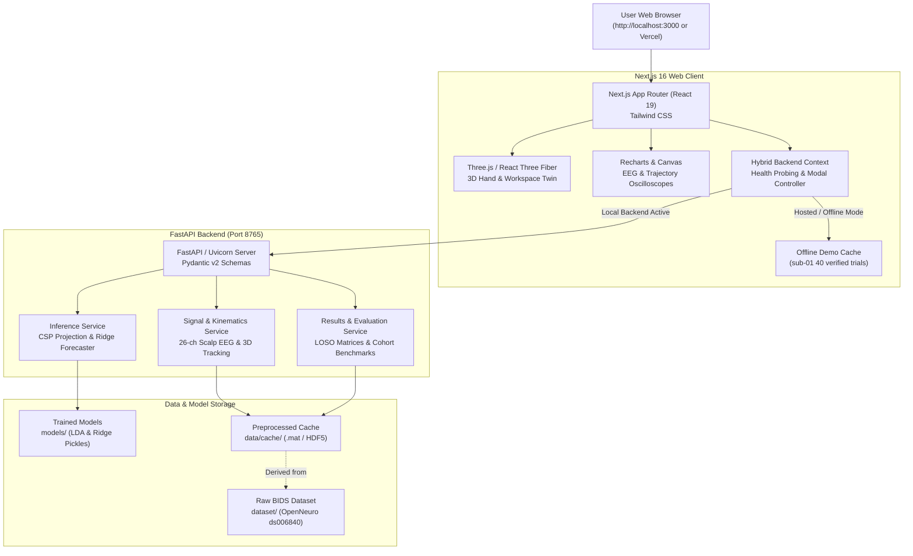

# NeuroAction — System Architecture & Deployment Design

This document details the software architecture, modular component structure, and deployment design of the **NeuroAction** platform.

---

## High-Level Architectural Diagram

---

## 1. Frontend Architecture (`web/frontend/`)

The web client is built on **Next.js 16** with **React 19**, **Tailwind CSS**, and **TypeScript**.

### Key Pages & Routes
- `/`: Interactive landing page with the wide 3D digital-twin stage, synchronized sensorimotor oscilloscope, research abstract, and four-stage pipeline.
- `/science`: 6-stage educational walkthrough of readiness potentials, spectral power, CSP projections, and kinematic geometry.
- `/model-lab`: Testing workbench with trial selector (269 trials across 5 participants), playback scrubbing controls, pipeline timeline, and 2D trajectory forecast charts.
- `/digital-twin`: Dedicated 3D WebGL digital twin featuring an articulated procedural hand, Cartesian axes, forecast continuation cones, and spatial targets.
- `/explainability`: Multi-channel EEG inspection (all 26 electrodes) with zoom/pan, signed LDA motor channel weights, and non-causal filter disclosures.
- `/evidence`: Verified 5-fold Leave-One-Subject-Out (LOSO) benchmark comparisons, participant breakdowns, and scientific boundaries.

### Hybrid Mode & Safe Vercel Deployment
To enable deployment to static hosting platforms like Vercel without requiring a dedicated Python GPU/CPU server:
1. **Offline Demo Data (`lib/sub01DemoData.ts`)**: 40 real, uncompressed reach trials for participant `sub-01` are pre-bundled into the client bundle.
2. **Backend Context (`lib/backend-context.tsx`)**: Periodically probes `http://127.0.0.1:8765/api/health`. When the backend is unavailable, it gracefully routes UI queries to the offline demo data.
3. **Backend Notice Modal (`components/modals/BackendNoticeModal.tsx`)**: When a user selects a backend-dependent feature (e.g. switching to `sub-02`–`sub-15` or requesting live retrained model inference), an informative modal explains that the hosted deployment operates on sample participant `sub-01`, directing the user to clone the repository for full multi-subject backend access.

---

## 2. Backend Architecture (`web/backend/`)

The server is built with **FastAPI** (Python 3.10) running on **Uvicorn** at port `8765`.

### Directory Layout
- `main.py`: Application entrypoint, CORS configuration, lifespan state management, and router registration.
- `schemas.py`: Pydantic models guaranteeing type safety and contract integrity.
- `routers/`:
  - `health.py`: Service health and active data source verification (`/api/health`).
  - `participants.py`: Participant discovery and metadata (`/api/participants`).
  - `trials.py`: Trial listing, timeseries coordinates, and kinematics (`/api/trials/{trial_id}`).
  - `signals.py`: 26-channel raw EEG potentials and zero-phase filter disclosure (`/api/signals/{trial_id}/eeg`).
  - `inference.py`: Live CSP projection and Ridge kinematic forecasting (`/api/inference/forecast`).
  - `evaluation.py`: Verified cohort and participant benchmark metrics (`/api/evaluation/cohort`).
  - `explainability.py`: Spatial LDA electrode weights and channel rankings (`/api/explainability/lda`).
- `services/`:
  - `registry_service.py`: Scans BIDS manifests and cache directories.
  - `inference_service.py`: Loads pickled scikit-learn Ridge forecasters and LDA decoders.
  - `results_service.py`: Serves historical evaluation matrices and LOSO benchmarks.

---

## 3. 3D WebGL Digital Twin Engine

The 3D visualization is rendered with **Three.js** and **React Three Fiber (R3F)**:
- **`HandModel.tsx`**: Procedural anatomical hand constructed from parametric primitives (palm box, wrist joint, five articulated finger rays with proximal, intermediate, and distal phalanges).
- **`Workspace3D.tsx`**: Physical interaction table, Leap Motion Cartesian axes ($X$: Lateral, $Y$: Height, $Z$: Depth), and illuminated goal targets.
- **`HeroWorkspace3D.tsx`**: Optimized wide-viewport stage designed specifically for the landing page hero section, featuring expanded 24-unit desk surface and smooth trajectory trails.
