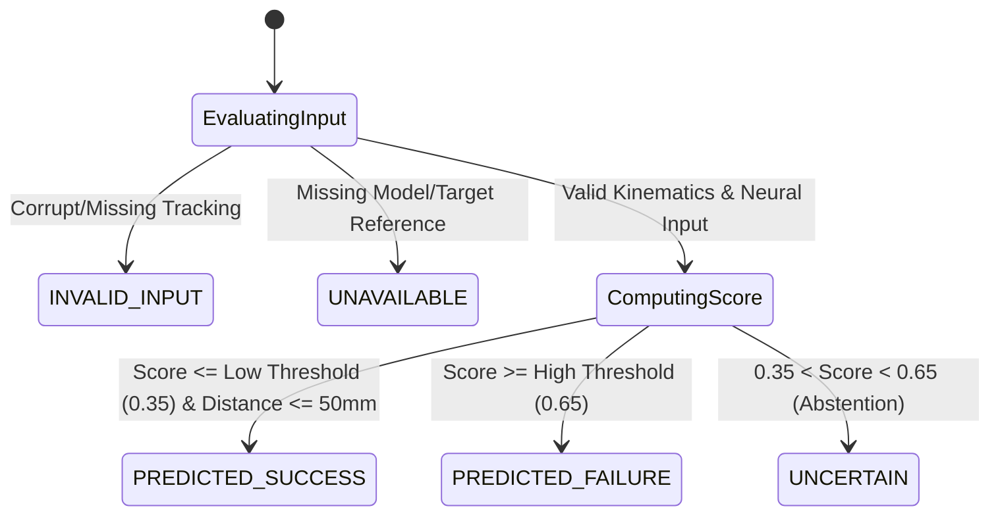

# NeuroAction Phase 5 — Data Dictionary and Interface Specification

**Document Version:** 1.0.0  
**Status:** Verified Phase 5 Artifact  
**Related Modules:** `src/phase_5/schemas.py`, `src/phase_5/external_validation.py`, `src/phase_5/target_reference.py`

---

## 1. Overview and Scope

This data dictionary formally defines the schemas, variable semantics, data types, physical units, coordinate frames, nullability, and valid value domains for all data structures utilized in NeuroAction Phase 5.

Phase 5 strictly distinguishes between:
1. **Instructed Visual Stimulus (`ball_dir`):** Screen-space cue presented to participant.
2. **Physical Reach Target (`intended_target_id`):** 3D spatial target the participant intended to reach.
3. **Decoded Neural Goal (`pred_neural_goal`):** Phase 2 electrophysiological prediction.
4. **Kinematic Forecast (`pred_endpoint`):** Phase 3 3D coordinate trajectory extrapolation.
5. **Observed Endpoint (`actual_endpoint`):** Physical coordinate of hand at trial termination.
6. **Target Success/Failure (`target_success`):** Binary physical outcome evaluation relative to target region.
7. **Condition Congruency (`congruent` vs `incongruent`):** Experimental design variable denoting cue-response rule.
8. **Intention–Action Discordance:** Discrepancy between biological goal and physical reach outcome.

---

## 2. Core Data Schemas

### 2.1 Target Reference Schema (`TargetReference`)
Defines the spatial geometry and provenance of a physical action target.

| Field Name | Type | Unit | Nullable | Description & Domain |
| :--- | :--- | :--- | :--- | :--- |
| `target_id` | `str` | N/A | No | Target identifier (`"left"`, `"right"`, `"center"`, or custom alphanumeric). |
| `coordinates` | `np.ndarray` (3,) | mm | No | 3D coordinate $[X, Y, Z]$ in calibrated physical space. |
| `tolerance_mm` | `float` | mm | No | Acceptance radius around target center ($> 0.0$, default $50.0\text{ mm}$). |
| `coordinate_frame` | `str` | N/A | No | Reference frame. Valid value: `"leap_motion_world_mm"`, `"vicon_world_mm"`. |
| `provenance` | `str` | N/A | No | Traceability string documenting coordinate origin (e.g., `"empirical_centroid_excluding_sub-01"`, `"mocap_ground_truth"`). |
| `is_authoritative` | `bool` | N/A | No | `False` if empirical proxy (e.g. centroids in `ds006840`); `True` if independently surveyed physical ground truth. |

---

### 2.2 Outcome Label Schema (`OutcomeLabel`)
Encapsulates the retrospectively computed ground-truth outcome of a completed movement.

| Field Name | Type | Unit | Nullable | Description & Domain |
| :--- | :--- | :--- | :--- | :--- |
| `trial_id` | `str` | N/A | No | Unique trial identifier (e.g., `"sub-01_run-01_tr00"`). |
| `target_id` | `str` | N/A | No | Targeted physical landmark ID. |
| `actual_endpoint` | `np.ndarray` (3,) | mm | Yes | Measured hand coordinate at movement completion. `None` if tracking lost. |
| `distance_to_target_mm` | `float` | mm | Yes | Euclidean distance $\|p_{\text{actual}} - p_{\text{target}}\|_2$. |
| `target_success` | `int` | binary | Yes | `1` if distance $\le$ `tolerance_mm`; `0` if distance $>$ `tolerance_mm`. `None` if endpoint unavailable. |
| `is_congruent` | `bool` | binary | No | Experimental task condition (stimulus-response congruency). Independent of success. |
| `outcome_status` | `str` | N/A | No | `"VALID"`, `"TARGET_UNAVAILABLE"`, `"ENDPOINT_MISSING"`, or `"TRACKING_INVALID"`. |

---

### 2.3 Trial Eligibility Record (`EligibilityRecord`)
Audits trial data integrity and eligibility for each prediction task before model evaluation.

| Field Name | Type | Unit | Nullable | Description & Domain |
| :--- | :--- | :--- | :--- | :--- |
| `trial_id` | `str` | N/A | No | Unique trial identifier. |
| `participant_id` | `str` | N/A | No | Participant identifier (`"sub-01"`, `"sub-02"`, `"sub-03"`, `"sub-08"`, `"sub-15"`). |
| `run_id` | `str` | N/A | No | Acquisition run identifier (e.g., `"run-01"`). |
| `trial_index` | `int` | N/A | No | Zero-based index within run. |
| `ball_dir` | `str` | N/A | No | Instructed stimulus direction (`"left"`, `"right"`). |
| `hand_dir` | `str` | N/A | No | Instructed hand direction (`"left"`, `"right"`). |
| `congruency` | `str` | N/A | No | `"congruent"` or `"incongruent"`. |
| `has_eeg` | `bool` | binary | No | `True` if pre-movement EEG epoch is present and non-empty. |
| `has_valid_prefix` | `bool` | binary | No | `True` if kinematic prefix ($t \le 200\text{ ms}$ or onset) has $\ge 3$ valid samples. |
| `has_valid_endpoint` | `bool` | binary | No | `True` if endpoint measurement is finite and tracking is intact. |
| `has_independent_target` | `bool` | binary | No | `True` if independent surveyed target coordinates exist. (`False` for `ds006840`). |
| `has_authoritative_outcome`| `bool` | binary | No | `True` if independent biological outcome ground truth is established. (`False` for `ds006840`). |
| `eligible_task_a` | `bool` | binary | No | Eligible for Task A (Neural visual-goal decoding). |
| `eligible_task_b` | `bool` | binary | No | Eligible for Task B (Kinematic trajectory forecasting). |
| `eligible_task_c` | `bool` | binary | No | Eligible for Task C (Exploratory target-reaching proxy evaluation). |
| `eligible_task_f` | `bool` | binary | No | Eligible for Task F (Multimodal outcome fusion). |
| `exclusion_reason` | `str` | N/A | Yes | Reason for exclusion (e.g., `"missing_kinematic_tracking"`, `"short_prefix"`). |

---

### 2.4 Prospective Prediction Schema (`Phase5Prediction`)
Captures a causal prediction generated strictly prior to movement completion.

| Field Name | Type | Unit | Nullable | Description & Domain |
| :--- | :--- | :--- | :--- | :--- |
| `trial_id` | `str` | N/A | No | Unique trial identifier. |
| `participant_id` | `str` | N/A | No | Participant identifier. |
| `prediction_time_ms` | `float` | ms | No | Exact timestamp when prediction was generated relative to trial onset. |
| `input_window_ms` | `tuple[float, float]`| ms | No | `(start_ms, end_ms)` interval of kinematics available to forecaster. |
| `forecast_model_id` | `str` | N/A | No | Trajectory forecaster ID (e.g., `"ridge_forecaster_v1"`). |
| `neural_model_id` | `str` | N/A | No | Neural decoder ID (e.g., `"csp_lda_eeg_v1"`). |
| `fusion_model_id` | `str` | N/A | No | Multimodal fusion engine ID. |
| `fold_id` | `str` | N/A | No | Cross-validation fold identifier (e.g., `"held_out_sub01"`). |
| `training_participants`| `list[str]` | N/A | No | Complete list of participant IDs used to train model. |
| `neural_goal_pred` | `str` | N/A | No | Decoded neural goal (`"left"`, `"right"`). |
| `neural_confidence` | `float` | $[0, 1]$ | No | Posterior probability from neural decoder. |
| `pred_endpoint` | `np.ndarray` (3,) | mm | No | Predicted 3D endpoint coordinate $[X, Y, Z]$. |
| `distance_to_target_mm`| `float` | mm | No | Euclidean distance from predicted endpoint to intended target coordinate. |
| `directional_angle_deg`| `float` | deg | No | Angle between forecast vector and target vector in X-Z plane. |
| `continuous_score` | `float` | $[0, 1]$ | No | Continuous discordance/failure risk score from fusion model. |
| `decision_policy_state`| `str` | N/A | No | State from `DecisionPolicyState` enum. |
| `is_abstention` | `bool` | binary | No | `True` if system abstained from making a categorical prediction. |
| `is_coverage` | `bool` | binary | No | `True` if system issued an active prediction (`PREDICTED_SUCCESS` or `PREDICTED_FAILURE`). |

---

## 3. Decision Policy States (`DecisionPolicyState`)

The categorical decision policy maps continuous multimodal risk scores and geometric constraints to actionable discrete states:



1. **`PREDICTED_SUCCESS`**: Continuous failure risk score $\le 0.35$ AND predicted endpoint is within target tolerance ($50.0\text{ mm}$).
2. **`PREDICTED_FAILURE`**: Continuous failure risk score $\ge 0.65$. High probability of target miss or intention–action discordance.
3. **`UNCERTAIN`**: Prediction score falls in ambiguous margin $(0.35, 0.65)$. The system actively abstains to preserve safety and precision.
4. **`UNAVAILABLE`**: Required model artifacts, calibration parameters, or target coordinate references are absent.
5. **`INVALID_INPUT`**: Kinematic prefix duration $< 100\text{ ms}$, tracking data corrupt, or timestamp sequencing non-monotonic.

---

## 4. Master Evaluation Matrix Schema (`phase_5_evaluation_matrix.csv`)

The authoritative 269-row evaluation CSV schema combines prospective predictions, ground-truth outcomes, and provenance tracking:

```csv
trial_id,participant_id,run_id,trial_index,congruency,ball_dir,hand_dir,
eligibility_status,exclusion_reason,
target_id,target_coord_x,target_coord_y,target_coord_z,target_provenance,is_target_authoritative,
actual_endpoint_x,actual_endpoint_y,actual_endpoint_z,endpoint_error_mm,actual_target_success,
neural_pred_goal,neural_confidence,
ridge_pred_x,ridge_pred_y,ridge_pred_z,ridge_endpoint_error_mm,
cv_pred_x,cv_pred_y,cv_pred_z,cv_endpoint_error_mm,
persistence_pred_x,persistence_pred_y,persistence_pred_z,persistence_endpoint_error_mm,
fusion_score,calibrated_prob,decision_policy_state,is_abstention,is_coverage,
fold_id,training_subjects_hash,software_version,evaluation_timestamp
```

---

## 5. External Validation Dataset Ingestion Schema (`external_validation.csv`)

Any prospective dataset collected in future experimental campaigns must strictly adhere to the following schema for automated validation:

### 5.1 Required Columns
1. `participant_id` (`str`): Anonymized participant code matching regex `^sub-[a-zA-Z0-9]+$`.
2. `session_id` (`str`): Session code matching regex `^ses-[a-zA-Z0-9]+$`.
3. `trial_id` (`str`): Globally unique trial identifier.
4. `intended_target_id` (`str`): Explicit physical action goal (`"left"`, `"right"`, `"center"`).
5. `target_x_mm` (`float`): Calibrated physical target X coordinate in mm.
6. `target_y_mm` (`float`): Calibrated physical target Y coordinate in mm.
7. `target_z_mm` (`float`): Calibrated physical target Z coordinate in mm.
8. `target_tolerance_mm` (`float`): Acceptance tolerance radius (typically $50.0\text{ mm}$).
9. `coordinate_frame` (`str`): Valid calibrated frame (`"leap_motion_world_mm"` or `"vicon_world_mm"`).
10. `eeg_start_timestamp_ms` (`float`): Absolute or epoch-relative EEG onset timestamp.
11. `eeg_end_timestamp_ms` (`float`): Pre-movement window closure timestamp.
12. `kinematic_prefix_start_ms` (`float`): Observation start timestamp for hand motion.
13. `kinematic_prefix_end_ms` (`float`): Observation cutoff timestamp (prediction issue time).
14. `actual_endpoint_x_mm` (`float`): Hand coordinate at trial completion.
15. `actual_endpoint_y_mm` (`float`): Hand coordinate at trial completion.
16. `actual_endpoint_z_mm` (`float`): Hand coordinate at trial completion.
17. `target_success` (`int`): Independently annotated outcome ($1 = \text{success}, 0 = \text{failure}$).
18. `is_congruent` (`int`): Experimental cue-response rule ($1 = \text{congruent}, 0 = \text{incongruent}$).
19. `tracking_quality_flag` (`str`): `"VALID"`, `"OCCLUDED"`, `"LOST_TRACKING"`.
20. `data_provenance` (`str`): Traceability documentation.

### 5.2 Strict Validation Constraints
- **Coordinate Consistency:** Coordinates outside $[-500, 500]\text{ mm}$ (X), $[0, 800]\text{ mm}$ (Y), $[-500, 500]\text{ mm}$ (Z) are rejected as sensor artifacts.
- **Causal Timing:** `kinematic_prefix_end_ms` must be strictly $< \text{trial completion timestamp}$.
- **Independence:** Target coordinates must not be computed from `actual_endpoint` values of the imported dataset.
- **Null Handling:** Missing `actual_endpoint` requires `tracking_quality_flag != "VALID"` and `target_success = null`.
