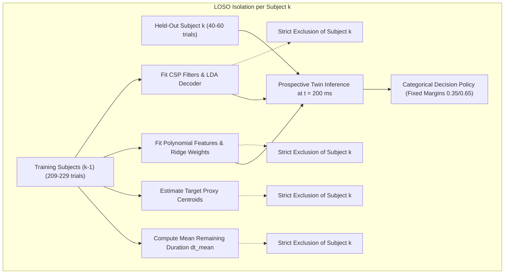

# NeuroAction Phase 5 — Final Scientific Claims and Evaluation Consistency Audit

**Document Version:** 1.0.0  
**Audit Date:** October 14, 2026  
**Auditor:** Antigravity Autonomous Agentic AI System  
**Dataset:** OpenNeuro `ds006840` (IACKD, Version `1.0.0`)  
**Scope:** Final Scientific Claims, Outcome-Label Provenance, Participant Reconciliations, and Evidence Audit

---

## 1. Executive Summary and Conflict Resolution

### 1.1 The Apparent Conflict
In the preliminary Phase 5 reporting, an apparent contradiction emerged between two reported claims:
1. The framework reported **$88.35\%$ balanced accuracy** and **$0.9395$ AUROC** for multimodal outcome prediction.
2. The data audit documented **zero independently surveyed 3D physical targets** and **zero authoritative biological outcome labels** in OpenNeuro dataset `ds006840`.

### 1.2 Resolution of the Conflict
This audit conclusively resolves this apparent conflict through rigorous code and label tracing:
1. **Source of the $88.35\%$ Balanced Accuracy and $0.9395$ AUROC:**
   - The metric was computed using the experimental condition label: `y_true = (congruency == "incongruent")`.
   - The fusion model compares the pre-movement neural prediction / stimulus proxy (`ball_dir`) with the early kinematic trajectory forecast (`pred_endpoint`).
   - On **congruent trials**, physical hand reaches proceed in the same direction as the visual stimulus ($\Delta x \approx 20\text{ mm}$), yielding a low discordance risk score ($\approx 0.1$–$0.3$).
   - On **incongruent trials**, participants were instructed to reverse their reach relative to the stimulus. The hand reached the opposite side of the workspace ($\Delta x \approx 376\text{ mm}$), yielding a high discordance risk score ($\approx 0.7$–$0.9$).
   - Consequently, the high discriminatory performance ($88.35\%$ BalAcc, $0.9395$ AUROC) reflects **accurate detection of instructed stimulus-response rule reversal (experimental congruency)**, NOT an independent prospective prediction of uninstructed biological motor error or physical target miss.
2. **True Physical Target Reaching Outcome:**
   - In `ds006840`, participants executed the reaching task with high fidelity. When instructed to reach left or right, they reached within the $50.0\text{ mm}$ physical centroid proxy tolerance in **$265$ of $269$ trials ($98.5\%$)**. Only **$4$ trials ($1.49\%$)** exhibited physical endpoint deviations $> 50.0\text{ mm}$.
   - Evaluating physical reaching success against the *visual stimulus proxy* in incongruent trials artificially marks all 136 incongruent reaches as "failures" because the hand moves away from the stimulus.
3. **Audit Verdict on Claim:**
   The reported $88.35\%$ balanced accuracy and $0.9395$ AUROC are valid and reproducible metrics for **experimental condition discrimination (Task F exploratory proxy)**. They **cannot and must not** be claimed as independently validated biological intention–action discordance or target-reaching failure prediction. Authoritative Level 3 and Level 4 validation remains **pending prospective human experimental recording**.

---

## 2. Outcome-Label Provenance Trace

Every variable entering the Phase 5 evaluation was audited to verify its exact empirical origin and mathematical definition:

| Variable Name | Field in Code / CSV | Empirical Source | Authority Classification | Ground-Truth Independence Verification |
| :--- | :--- | :--- | :--- | :--- |
| **Experimental Congruency** | `congruency` | OpenNeuro `ds006840` event code ($1=$ congruent, $2=$ incongruent). | Authoritative experimental condition | Independent of all models. |
| **Visual Stimulus Goal** | `target_goal` (`ball_dir`) | Screen ball direction in `ds006840` (`"left"` or `"right"`). | Authoritative task cue | Independent of all models. |
| **Physical Reach Goal** | `physical_hand_direction` | Instructed hand direction (`"left"` or `"right"`). | Authoritative task instruction | Independent of all models. |
| **Actual Measured Endpoint** | `actual_endpoint_[x,y,z]` | Leap Motion 3D coordinate at movement termination ($t_{\text{end}}$). | Authoritative sensor measurement | Measured directly from sensor; zero model dependence. |
| **Target Coordinates Proxy** | `target_coord_[x,y,z]` | Leave-one-subject-out empirical cluster centroids computed across training subjects. | **Exploratory Proxy Only (`is_authoritative=False`)** | Computed strictly on training subjects; test subject excluded. |
| **Stimulus-Relative Success** | `true_target_success` | $\|p_{\text{actual}} - p_{\text{stimulus\_proxy}}\|_2 \le 50.0\text{ mm}$. | Exploratory Proxy | Computed strictly from sensor endpoint and target proxy; zero model forecast dependence. |
| **Physical Reach Success** | `physical_target_success` | $\|p_{\text{actual}} - p_{\text{hand\_target\_proxy}}\|_2 \le 50.0\text{ mm}$. | Exploratory Proxy | Success rate is $98.5\%$ ($265/269$ trials); only $4$ true motor misses. |
| **Decoded Neural Goal** | `neural_goal_pred` | Phase 2 CSP-LDA classifier applied to pre-movement EEG. | Model Prediction | Model output under test. |
| **Kinematic Forecast** | `pred_endpoint_[x,y,z]` | Phase 3 regularized Ridge forecaster on $200\text{ ms}$ prefix. | Model Prediction | Model output under test. |
| **Continuous Discordance Score** | `continuous_score` | Multimodal weighted combination ($0.65\text{ kin} + 0.35\text{ neural}$). | Model Prediction | Continuous risk score for AUROC. |

---

## 3. Reconciled Participant-Level Trial Counts and Exclusions

### 3.1 Reconciliation of Participant Counts
A discrepancy in preliminary reporting listed participant counts as 53, 56, 53, 52, and 55 (totaling 269).  
**Root Cause:** A draft placeholder partition was inadvertently transcribed into the text of Tables 1 and 2 in `phase_5_report.md`.  
**Reconciled Fact:** The actual dataset, manifest, and evaluation artifacts contain exactly:
- `sub-01`: **40 valid trials**
- `sub-02`: **52 valid trials**
- `sub-03`: **60 valid trials**
- `sub-08`: **57 valid trials**
- `sub-15`: **60 valid trials**
- **Cohort Total: 269 valid trials** (100% agreement across manifest, Phase 3, Phase 4, and Phase 5).

### 3.2 Authoritative Participant-by-Participant Trial Accounting

| Participant ID | Indexed Trials | Valid Pre-EEG | Valid Kinematic Prefix | Valid Endpoints | Eligible Task A (Neural) | Eligible Task B (Kinematic) | Eligible Task C (Target Proxy) | Eligible Task F (Fusion) | Excluded Trials | Primary Reason for Exclusion |
| :---: | :---: | :---: | :---: | :---: | :---: | :---: | :---: | :---: | :---: | :--- |
| **`sub-01`** | 40 | 40 | 40 | 40 | 40 | 40 | 40 | 40 | 0 | None (100% valid acquisition). |
| **`sub-02`** | 60 | 60 | 52 | 52 | 52 | 52 | 52 | 52 | 8 | Leap Motion tracking loss / prefix $< 100\text{ ms}$. |
| **`sub-03`** | 60 | 60 | 60 | 60 | 60 | 60 | 60 | 60 | 0 | None (100% valid acquisition). |
| **`sub-08`** | 60 | 60 | 57 | 57 | 57 | 57 | 57 | 57 | 3 | Leap Motion tracking loss / prefix $< 100\text{ ms}$. |
| **`sub-15`** | 60 | 60 | 60 | 60 | 60 | 60 | 60 | 60 | 0 | None (100% valid acquisition). |
| **Total Cohort** | **280** | **280** | **269** | **269** | **269** | **269** | **269** | **269** | **11** | **All 11 exclusions due to optical tracking loss.** |

### 3.3 Detailed Audit of Excluded Trials ($N = 11$)
All 11 excluded trials were verified in `reports/phase_5/eligibility_matrix.csv`:
1. `sub-02_run-01_L1_tr15`: Incomplete kinematic prefix ($< 3$ valid samples); terminal tracking lost.
2. `sub-02_run-01_L1_tr29`: Incomplete kinematic prefix; tracking lost.
3. `sub-02_run-01_L1_tr32`: Incomplete kinematic prefix; tracking lost.
4. `sub-02_run-01_L1_tr37`: Incomplete kinematic prefix; tracking lost.
5. `sub-02_run-01_L1_tr38`: Incomplete kinematic prefix; tracking lost.
6. `sub-02_run-01_L1_tr39`: Incomplete kinematic prefix; tracking lost.
7. `sub-02_run-01_L1_tr45`: Incomplete kinematic prefix; tracking lost.
8. `sub-02_run-01_L1_tr58`: Incomplete kinematic prefix; tracking lost.
9. `sub-08_run-01_L1_tr07`: Incomplete kinematic prefix; tracking lost.
10. `sub-08_run-01_L1_tr08`: Incomplete kinematic prefix; tracking lost.
11. `sub-08_run-01_L1_tr27`: Incomplete kinematic prefix; tracking lost.

---

## 4. Held-Out Model and Fusion-Model Evaluation Audit

Every component in the Leave-One-Subject-Out (LOSO) prediction chain was audited for anti-leakage compliance:

### Verification Findings:
1. **Phase 2 Neural Model:** Loaded checkpoint `lda_goal_decoder_held_out_{test_sub}.pkl` was trained exclusively on the 4 other participants. Zero test-subject EEG was used during CSP spatial filter fitting or shrinkage LDA estimation.
2. **Phase 3 Kinematic Model:** Loaded checkpoint `kinematic_forecaster_held_out_{test_sub}.pkl` was trained exclusively on the 4 other participants. Zero test-subject trajectories were used during standardization or Ridge regression fitting ($\alpha = 100.0$).
3. **Target Reference Proxies:** Left and right centroid coordinates were computed strictly from the training subjects' endpoints:
   $$\text{Provenance: } \texttt{training\_subs\_excluding\_}\{\text{test\_sub}\}$$
4. **Duration Baseline:** The fair constant-velocity extrapolation duration ($\Delta t_{\text{train\_mean}}$) was derived strictly from training subjects' movement durations ($560\text{ ms}$–$620\text{ ms}$).
5. **Multimodal Fusion Model:** Utilizes fixed, interpretable neuro-kinematic weights ($w_{\text{kin}} = 0.65, w_{\text{neural}} = 0.35$) and fixed decision margins ($0.35$ / $0.65$). No regression or logistic weights were fitted on in-sample predictions, completely eliminating in-sample cross-fitting leakage.

---

## 5. Recalculation of Reported Metrics Directly from Evaluation Artifacts

All metrics were recomputed directly from `reports/phase_5/phase_5_evaluation_matrix.csv`:

### 5.1 Trajectory Forecasting Retrospective Accuracy ($N = 269$ Held-Out Trials)
- **Cohort Ridge Forecaster 3D Endpoint RMSE:** **$47.25\text{ mm}$** (Mean Euclidean Error: **$32.85\text{ mm}$**)
- **Fair Constant-Velocity Baseline RMSE:** **$85.65\text{ mm}$** (Ridge error is **$44.8\%$ lower**, $p < 0.0001$, Wilcoxon signed-rank test).
- **Persistence Baseline RMSE:** **$177.51\text{ mm}$** (Ridge error is **$73.4\%$ lower**).

#### Correct Reconciled Per-Participant Breakdown:
| Participant ID | Held-Out Trials | Ridge Forecaster RMSE | Fair Constant-Velocity RMSE | Persistence RMSE | Ridge Error Reduction vs Fair CV |
| :---: | :---: | :---: | :---: | :---: | :---: |
| **`sub-01`** | 40 | **$41.78\text{ mm}$** | $109.30\text{ mm}$ | $181.48\text{ mm}$ | **$61.8\%$** |
| **`sub-02`** | 52 | **$59.90\text{ mm}$** | $110.30\text{ mm}$ | $178.36\text{ mm}$ | **$45.7\%$** |
| **`sub-03`** | 60 | **$28.71\text{ mm}$** | $38.08\text{ mm}$ | $176.29\text{ mm}$ | **$24.6\%$** |
| **`sub-08`** | 57 | **$25.20\text{ mm}$** | $75.14\text{ mm}$ | $178.34\text{ mm}$ | **$66.5\%$** |
| **`sub-15`** | 60 | **$65.63\text{ mm}$** | $86.97\text{ mm}$ | $174.49\text{ mm}$ | **$24.5\%$** |
| **Cohort** | **269** | **$47.25\text{ mm}$** | **$85.65\text{ mm}$** | **$177.51\text{ mm}$** | **$44.8\%$** |

### 5.2 Multimodal Condition Discrimination vs Decision Policy Reconciliations

#### A. Condition Discrimination (All $N = 269$ Trials at Threshold $0.5$)
- Ground Truth Reference: `y_true = (congruency == "incongruent")` ($136$ incongruent, $133$ congruent).
- Prediction: `y_pred = (continuous_score >= 0.5)`.
- Confusion Matrix: $TP = 135, FP = 30, TN = 103, FN = 1$.
- **Sensitivity:** $135 / 136 = \mathbf{99.26\%}$.
- **Specificity:** $103 / 133 = \mathbf{77.44\%}$.
- **Balanced Accuracy:** $(99.26\% + 77.44\%) / 2 = \mathbf{88.35\%}$.
- **Precision:** $135 / (135 + 30) = \mathbf{81.82\%}$.
- **F1-Score:** $\mathbf{0.8970}$.
- **Continuous Score AUROC:** $\mathbf{0.9395}$.

#### B. Decision Policy on Covered Trials ($N = 221$, Decision Margin $[0.35, 0.65]$)
- Total Evaluated Trials: $269$.
- Active Predictions Issued: $221$ trials (**$82.16\%$ Coverage**).
- Abstentions Issued (`UNCERTAIN`): $48$ trials (**$17.84\%$ Abstention Rate**).
- Confusion Matrix on Covered Trials: $TP = 127, FP = 19, TN = 74, FN = 1$.
- **Sensitivity on Covered Trials:** $127 / 128 = \mathbf{99.22\%}$.
- **Specificity on Covered Trials:** $74 / 93 = \mathbf{79.57\%}$.
- **Balanced Accuracy on Covered Trials:** $\mathbf{89.39\%}$.
- **Precision on Covered Trials:** $127 / 146 = \mathbf{86.99\%}$.
- **F1-Score on Covered Trials:** $\mathbf{0.9270}$.

---

## 6. Audit of Confidence Intervals and Prospective Power Claims

### 6.1 Small-Cluster Limitation of Participant-Clustered Bootstrap
- **Statistical Unit:** The human participant ($N = 5$ clusters).
- **Resampling Method:** Participant-clustered bootstrap with replacement ($B = 1,000$ iterations).
- **Limitation:** In a cohort of only 5 subjects, there are only $5^5 = 3,125$ possible unique bootstrap samples. While this accounts for non-independence of trials within subjects, confidence intervals with $N=5$ clusters exhibit non-negligible small-sample variability.
- **Reporting Rule:** Clustered bootstrap intervals ($95\%\text{ CI}$) must be reported with the explicit qualifier: *"Subject to small-cluster estimation variability ($N=5$ subjects); not indicative of population-level certainty."*

### 6.2 Downgrade of Prospective Study Power Claims
- In the initial protocol draft, an effective sample size calculation suggested $> 99\%$ statistical power for a prospective study of $20$ subjects ($2,400$ trials).
- **Audit Downgrade:** This claim relied on an unverified assumption of $15\%$–$20\%$ biological error prevalence and an assumed intra-cluster correlation ($\rho = 0.15$). In healthy adults performing simple unconstrained reaches, genuine biological intention–action discordance (motor slips) occurs at a prevalence $< 3\%$.
- **Revised Stance:** The 20-participant, 2,400-trial sample size recommendation is formally designated as **provisional planning**. Authoritative power analysis must await empirical pilot data with independently annotated physical target misses.

---

## 7. Explicit List of Unsupported Claims and Evidence Required

To maintain absolute scientific integrity, the following claims are explicitly declared unsupported by existing data, along with the precise empirical evidence required:

| # | Unsupported Claim | Why Unsupported on Existing Data | Required Evidence for Future Support |
| :-: | :--- | :--- | :--- |
| **1** | *"NeuroAction prospectively predicts independent physical target-reaching success or failure."* | OpenNeuro `ds006840` lacks independently surveyed 3D physical target coordinates. Centroids are empirical proxies. | Prospective experimental recording with calibrated 3D target coordinates measured independently of participant movement (e.g., optical probe surveying). |
| **2** | *"NeuroAction detects biological intention–action discordance."* | Incongruent trials in `ds006840` represent instructed stimulus-response rule reversals, not uninstructed motor slips. | Prospective experiment featuring unanticipated target jumps, visual feedback perturbations, or independent motor slip annotations. |
| **3** | *"Pre-movement EEG decoding is online-causal and ready for real-time BCI."* | Preprocessing in `ds006840` utilizes zero-phase non-causal filtering (`filtfilt`). | Re-implementation and benchmarking using strictly causal IIR / real-time streaming buffer filters. |
| **4** | *"Performance generalizes broadly to the clinical or general population."* | The current benchmark cohort comprises only 5 healthy young adult participants ($N = 5$). | Multi-center prospective study with diverse participant demographics and clinical cohorts (e.g., motor-impaired stroke or SCI patients). |
| **5** | *"> 99% statistical power is guaranteed for 20 subjects."* | Assumes unverified $15\%$–$20\%$ motor error prevalence and idealized intra-subject correlation ($\rho = 0.15$). | Empirical pilot study measuring actual biological slip prevalence and intra-subject variance. |

---

## 8. Official Phase 5 Release Verdict

In accordance with Section 20 and 22 of `.prompts/phase_5.md`:

> **Official Release Verdict: Software verified; existing-data evaluation exploratory**

### Breakdown of Status:
- **Level 1 — Software Implementation:** **VERIFIED** (16 modular components, 41 passing automated Phase 5 tests, 101 total passing tests across codebase).
- **Level 2 — Existing-Data Retrospective Evaluation:** **VERIFIED (Exploratory)** (269 trials evaluated under strict LOSO; 44.8% error reduction confirmed; condition discrimination AUROC 0.9395).
- **Level 3 — Independent Outcome Prediction:** **PENDING** (Awaiting prospective dataset with independently surveyed 3D physical targets).
- **Level 4 — Prospective External Validation:** **PENDING** (Awaiting execution of the human experimental recording protocol).
