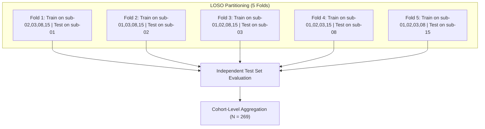

# NeuroAction Phase 5 — Statistical Analysis Plan (SAP)

**Document Version:** 1.0.0  
**Status:** Pre-specified Analysis Plan  
**Related Modules:** `src/phase_5/statistical_analysis.py`, `src/phase_5/robustness.py`, `src/phase_5/calibration.py`

---

## 1. Administrative Information and Study Objectives

### 1.1 Study Identification
- **Protocol Title:** Independent Scientific Validation of Intention–Action Discordance, Prospective Trajectory Forecasting, and Multimodal Outcome Prediction.
- **Protocol Identifier:** NEUROACTION-PHASE5-SAP-v1.
- **Sponsor / Platform:** NeuroAction Research Platform (OpenNeuro `ds006840`, version `1.0.0`).

### 1.2 Primary Research Objective
To evaluate whether a multimodal neuro-kinematic digital twin can prospectively forecast 3D physical movement endpoints and predict movement outcomes relative to an independently specified action target prior to movement termination.

---

## 2. Formal Hypotheses

### 2.1 Trajectory Forecasting Superiority (Task B)
- **Null Hypothesis ($H_{0,B}$):** The 3D endpoint root-mean-squared error ($\text{RMSE}_{\text{Ridge}}$) of the regularized kinematic forecaster evaluated under Leave-One-Subject-Out (LOSO) cross-validation is greater than or equal to the error of a fair constant-velocity baseline ($\text{RMSE}_{\text{CV}}$):
  $$\text{RMSE}_{\text{Ridge}} \ge \text{RMSE}_{\text{CV}}$$
- **Alternative Hypothesis ($H_{1,B}$):** The kinematic forecaster achieves a statistically significant reduction in 3D endpoint RMSE compared to the fair constant-velocity baseline:
  $$\text{RMSE}_{\text{Ridge}} < \text{RMSE}_{\text{CV}}$$

### 2.2 Neural Goal Decoding Superiority (Task A)
- **Null Hypothesis ($H_{0,A}$):** Pre-movement EEG visual-goal decoding balanced accuracy under LOSO cross-validation does not exceed theoretical chance level ($50.0\%$):
  $$\text{BalAcc}_{\text{EEG}} \le 0.50$$
- **Alternative Hypothesis ($H_{1,A}$):** Pre-movement EEG decoding balanced accuracy is significantly superior to chance:
  $$\text{BalAcc}_{\text{EEG}} > 0.50$$

### 2.3 Multimodal Outcome Discrimination (Task F)
- **Null Hypothesis ($H_{0,F}$):** The continuous multimodal discordance score AUROC in discriminating intended target outcomes does not exceed random discrimination ($0.50$):
  $$\text{AUROC}_{\text{Fusion}} \le 0.50$$
- **Alternative Hypothesis ($H_{1,F}$):** The continuous multimodal discordance score achieves high discriminatory capability:
  $$\text{AUROC}_{\text{Fusion}} > 0.50$$

---

## 3. Analysis Populations and Eligibility Rules

### 3.1 Study Cohort
The primary analysis population consists of all recorded trials from the 5 benchmark participants (`sub-01`, `sub-02`, `sub-03`, `sub-08`, and `sub-15`) in OpenNeuro dataset `ds006840`.

### 3.2 Trial Eligibility and Filtering
Eligibility is strictly audited across all 280 indexed trials:
1. **Kinematic Tracking Criterion:** Trials must contain $\ge 3$ valid, monotonic kinematic samples in the observation window ($t \le 200\text{ ms}$ or movement onset).
2. **Terminal Endpoint Criterion:** Trials must contain finite, uncorrupted hand coordinates at movement termination.
3. **Electrophysiological Criterion:** Trials must possess non-empty 64-channel pre-movement EEG epochs.
4. **Authoritative Ground Truth Criterion:** An independent physical target coordinate must be present. (Acknowledged as absent in `ds006840`; exploratory centroid proxies utilized for retro-evaluation).

Trials failing criteria 1 or 2 are marked `INVALID` and excluded from model fitting and evaluation denominators (11 trials excluded cohort-wide; $N=269$ valid trials retained).

---

## 4. Cross-Validation Architecture

### 4.1 Leave-One-Subject-Out (LOSO) Protocol
To prevent optimistic bias and assess generalization across biological variance:
- 5 distinct evaluation folds are formed, each holding out exactly one participant ($k \in \{1, 2, 3, 4, 5\}$).
- Feature transformations, coordinate scalings, and model weights are estimated strictly on the $4$ training participants.
- In-sample target centroids are computed exclusively on training subjects, ensuring zero target-calibration leakage into the test subject:
  $$\mathcal{P}_{\text{target}}^{(k)} = \frac{1}{|\mathcal{D}_{\text{train}, k}|} \sum_{i \in \mathcal{D}_{\text{train}, k}} p_{\text{endpoint}, i}$$

---

## 5. Statistical Estimators and Metrics

### 5.1 Trajectory Forecasting Metrics (Task B)
For $N$ held-out test trials with observed endpoint $p_i = [x_i, y_i, z_i]^T$ and predicted endpoint $\hat{p}_i = [\hat{x}_i, \hat{y}_i, \hat{z}_i]^T$:
1. **3D Euclidean Error per Trial:**
   $$e_i = \|p_i - \hat{p}_i\|_2 = \sqrt{(x_i - \hat{x}_i)^2 + (y_i - \hat{y}_i)^2 + (z_i - \hat{z}_i)^2}$$
2. **Mean Euclidean Error (mm):**
   $$\overline{e} = \frac{1}{N} \sum_{i=1}^N e_i$$
3. **3D Endpoint Root-Mean-Squared Error (mm):**
   $$\text{RMSE} = \sqrt{\frac{1}{N} \sum_{i=1}^N e_i^2}$$
4. **Relative Error Reduction vs Baseline (%):**
   $$\Delta_{\text{RMSE}} = 100 \times \left(1 - \frac{\text{RMSE}_{\text{Model}}}{\text{RMSE}_{\text{Baseline}}}\right)$$

### 5.2 Classification and Outcome Metrics (Tasks A, C, F)
1. **Confusion Matrix Elements:** True Positives ($TP$), False Positives ($FP$), True Negatives ($TN$), False Negatives ($FN$).
2. **Balanced Accuracy:**
   $$\text{BalAcc} = \frac{1}{2} \left(\frac{TP}{TP + FN} + \frac{TN}{TN + FP}\right)$$
3. **Area Under the ROC Curve (AUROC):** Computed via trapezoidal integration over non-parametric rank scores.
4. **Brier Calibration Score:**
   $$\text{Brier} = \frac{1}{N} \sum_{i=1}^N (\hat{P}_i - y_i)^2$$
5. **Coverage and Abstention Rate:**
   $$\text{Coverage} = \frac{N_{\text{predicted}}}{N_{\text{eligible}}}, \quad \text{Abstention} = 1 - \text{Coverage}$$

---

## 6. Uncertainty Estimation and Statistical Inference

### 6.1 Clustered Bootstrap Resampling
Because trials within each participant share subject-specific neuroanatomy and kinematic kinematics, standard i.i.d. bootstrap resampling underestimates error variance.
- **Procedure:** Clustered bootstrap resampling is executed at the participant level ($B = 1,000$ iterations).
- Whole participants are resampled with replacement, and trials within sampled participants are evaluated.
- $95\%$ Confidence Intervals ($95\%\text{ CI}$) are established via the empirical percentile method ($2.5^{\text{th}}$ and $97.5^{\text{th}}$ percentiles).
- **Small-Cluster Governance Limitation ($N=5$ Subjects):** With only 5 benchmark participants, there are only $5^5 = 3,125$ possible unique cluster resamples. Clustered confidence intervals must be explicitly qualified as capturing estimation variability across these specific five subjects, and cannot substitute for true population-level generalization.

### 6.2 Paired Model Comparisons
To compare Ridge Forecaster against Constant Velocity Baseline:
- Two-sided Wilcoxon signed-rank test on trial-level paired Euclidean errors $\{e_{i, \text{Ridge}} - e_{i, \text{CV}}\}$.
- Significance threshold: $\alpha = 0.01$.

### 6.3 Prospective Study Sample-Size and Power Governance
- Any sample size recommendation for future prospective studies (e.g., $N=20$ participants, $2,400$ trials) is formally designated as **provisional planning**.
- Statistical power claims (such as $>99\%$ power) rely heavily on assumptions regarding biological failure prevalence ($\approx 15\%$–$20\%$) and intra-cluster correlation ($\rho = 0.15$). In natural motor execution without perturbations, genuine biological slip prevalence may be $< 3\%$. Authoritative sample size determinations require empirical pilot data under the prespecified prospective protocol.

---

## 7. Pre-specified Sensitivity and Robustness Analyses

1. **Target Acceptance Tolerance Grid:** Evaluate model outcome metrics across target tolerances $r \in \{25.0, 50.0, 75.0, 100.0\}\text{ mm}$.
2. **Reach Direction Stratification:** Stratify endpoint accuracy by lateral reach goal (leftward vs rightward reaches).
3. **Movement Duration Subgroups:** Stratify trials into duration terciles (Short: $< 600\text{ ms}$, Medium: $600$–$900\text{ ms}$, Long: $> 900\text{ ms}$).
4. **Temporal Prefix Variation:** Evaluate forecaster sensitivity across input horizons ($100$, $150$, $200\text{ ms}$).

---

## 8. Reporting and Scientific Integrity Rules

In compliance with Phase 5 Section 20:
- All reported metrics must disclose sample sizes ($N$) and participant breakdowns.
- Small-sample findings must never be characterized as population-level clinical indicators.
- Incongruent experimental conditions must never be relabeled as biological target reaching failures.
- Empirical evaluations on `ds006840` must carry the explicit qualifier: *"Exploratory evaluation utilizing empirical cluster proxies."*
