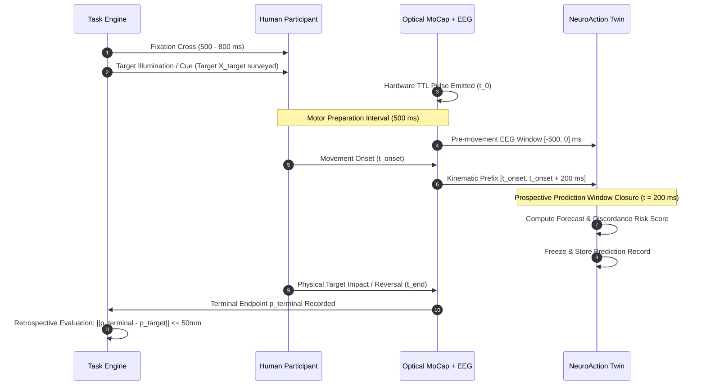

# NeuroAction Phase 5 — Prospective Validation Protocol

**Document Version:** 1.0.0  
**Status:** Protocol Specification for Future Human Experimental Recordings  
**Target Delivery:** Prospective Empirical Validation Milestone (Level 4 Validation)  
**Figure Reference:** `reports/phase_5/figures/figure_14_prospective_protocol_timeline.png`

---

## 1. Executive Summary and Scientific Justification

Current evaluations in NeuroAction Phases 1–4 and Phase 5 retrospective benchmarks rely on OpenNeuro dataset `ds006840` (IACKD). While `ds006840` offers rich synchronized EEG and optical hand tracking, it exhibits two structural experimental limitations:
1. **Absence of Independently Surveyed 3D Target Coordinates:** Physical spatial target locations were not instrumented; research analyses previously relied on post-hoc kinematic cluster centroids as proxies.
2. **Confounding of Stimulus Congruency with Action Outcome:** Incongruent trials reflect rule-reversal cognitive conflict, not uninstructed motor slips or biological reaching failures.

This document specifies the prospective human experimental protocol required to provide **authoritative Level 4 empirical validation** of NeuroAction.

---

## 2. Research Objectives and Pre-specified Criteria

### 2.1 Primary Scientific Aim
To determine whether NeuroAction's multimodal neuro-kinematic digital twin can prospectively predict physical target-reaching failure ($y_{\text{success}} = 0$) relative to an independently measured physical target region, using only electrophysiological and kinematic information recorded prior to movement termination.

### 2.2 Operational Target-Success Criterion
A movement is defined as successful if and only if the primary physical tracking marker (distal index fingertip) terminates within a prespecified geometric sphere centered on the surveyed physical target:
$$\text{target\_success} = \begin{cases} 1 & \text{if } \|p_{\text{terminal}} - p_{\text{target}}\|_2 \le r_{\text{tolerance}} \\ 0 & \text{otherwise} \end{cases}$$
where $r_{\text{tolerance}} = 50.0\text{ mm}$ (calibrated against index fingertip contact pad radius).

---

## 3. Experimental Architecture and Trial Sequence

The trial structure enforces absolute causal isolation between cue presentation, motor preparation, and online execution:

### 3.1 Step-by-Step Trial Timeline
1. **Fixation & Baseline Epoch ($-1300\text{ ms}$ to $-500\text{ ms}$):**
   Participant fixates on neutral central reticle. Baseline 64-channel EEG recorded.
2. **Target Cue & Instruction ($-500\text{ ms}$ to $0\text{ ms}$):**
   One of three physical LED targets (Left, Center, Right) illuminates. In discordance-probe blocks, subtle visual feedback shifts or target perturbations are introduced to elicit genuine movement corrections and occasional target misses.
3. **Hardware TTL Triggering ($t = 0\text{ ms}$):**
   Parallel port TTL pulse simultaneously marks the EEG amplifier and motion capture timeline with $< 10\,\mu\text{s}$ jitter.
4. **Pre-Movement Prediction Window ($0\text{ ms}$ to $t_{\text{onset}}$):**
   Pre-movement sensorimotor rhythm (mu/beta band, $8$–$30\text{ Hz}$) processed strictly forward-in-time using causal IIR filters (zero acausal zero-phase filtering).
5. **Kinematic Observation Prefix ($t_{\text{onset}}$ to $t_{\text{onset}} + 200\text{ ms}$):**
   First $200\text{ ms}$ of hand trajectory recorded via optical tracking.
6. **Prospective Twin Prediction ($t_{\text{pred}} = t_{\text{onset}} + 200\text{ ms}$):**
   Digital twin forecasts 3D trajectory $\hat{p}(t)$, predicts terminal endpoint $\hat{p}_{\text{terminal}}$, evaluates distance to $p_{\text{target}}$, and issues categorical prediction (`PREDICTED_SUCCESS`, `PREDICTED_FAILURE`, or `UNCERTAIN`). **Prediction record is immediately cryptographically hashed and saved.**
7. **Movement Completion and Ground Truth Verification ($t_{\text{end}}$):**
   Hand terminates reach. Optical tracking records $p_{\text{terminal}}$. Microswitch / contact sensor on target verifies physical contact independently of optical tracking.

---

## 4. Instrumentation and Data Acquisition

### 4.1 Calibrated Physical Target Setup
- Physical targets consist of three instrumented touch plates mounted on a semi-circular arc ($R = 300\text{ mm}$ from hand rest position).
- 3D target coordinates ($p_{\text{target}}$) are measured prior to acquisition using a calibrated optical measurement probe with sub-millimeter precision ($\pm 0.1\text{ mm}$).
- Target coordinates are stored in the experiment configuration file with cryptographic SHA-256 validation.

### 4.2 Multi-Sensor Synchronization
- **EEG Recording:** 64-channel active electrodes (10–20 montage, $1000\text{ Hz}$ sampling rate, DC-coupled).
- **Motion Capture:** 8-camera optical tracking system (Vicon or Qualisys, passive retroreflective markers, $200\text{ Hz}$ sampling rate).
- **Master Hardware Clock:** Dedicated digital I/O trigger box sending simultaneous 8-bit TTL words to EEG trigger port and MoCap digital acquisition board.
- **Clock Drift Correction:** Synchronization pulses sent every $10\text{ seconds}$ during acquisition; residual linear drift modeled and corrected to $< 0.5\text{ ms}$ alignment error.

---

## 5. Research Governance and Ethical Standards

1. **Institutional Review Board (IRB) / Research Ethics Committee (REC):**
   Protocol must receive formal ethical approval prior to participant recruitment.
2. **Informed Consent:**
   Written informed consent obtained from all participants, detailing procedure, non-invasive sensor application, and open-science anonymized data sharing.
3. **Data Protection and Privacy:**
   Full anonymization in compliance with GDPR and HIPAA. Direct identifiers removed; raw defaced kinematic and electrophysiological recordings assigned GUIDs.
4. **Non-Clinical Research Positioning:**
   Explicitly designated as basic human sensorimotor research. No real-time neuromuscular electrical stimulation, robotic force feedback, or clinical intervention is deployed.

---

## 6. Sample Size Planning and Provisional Power Analysis

### 6.1 Assumptions and Design Parameters
- **Primary Endpoint:** Prospective target-outcome discrimination AUROC (Task F).
- **Hypothesis:** Multimodal twin AUROC $\ge 0.80$ against null $\text{AUROC} = 0.50$.
- **Hypothesized Outcome Failure Prevalence:** $\approx 15\%$ to $20\%$ of trials (achieved through natural reaching variability and subtle spatial boundary conditions).
- **Type I Error Rate ($\alpha$):** $0.01$ (two-sided).
- **Target Statistical Power ($1 - \beta$):** $0.90$.
- **Assumed Intra-Subject Correlation (ICC):** $\rho = 0.15$ for clustering within participants.

### 6.2 Provisional Sample Size Recommendation
- **Trial Count per Subject:** 120 trials per participant (60 standard reaches, 40 discordance/perturbation probe reaches, 20 catch trials).
- **Participant Cohort:** $N = 20$ healthy adult participants (**Provisional Planning Target**).
- **Total Dataset:** $2,400$ recorded multimodal trials.
- **Power Sensitivity and Critical Limitations:** Under the assumption of $15\%$ failure event prevalence and an intra-cluster correlation $\rho = 0.15$ (design effect $\text{DE} = 1 + (120 - 1) \times 0.15 = 18.85$), the effective independent sample size would be $\approx 127$ independent failure events, yielding high nominal power ($> 90\%$) to detect an AUROC of $0.80$ via the Hanley-McNeil formulation. **However, this power estimation is strictly provisional.** In unconstrained natural movements without artificial perturbations, biological motor slips occur at a much lower prevalence ($< 3\%$). If failure prevalence is lower or intra-subject correlation is higher ($\rho > 0.3$), statistical power will decrease significantly. Authoritative sample-size determination must await empirical pilot data collection under this protocol.

---

## 7. Pre-registered Analysis Plan

Prior to data collection and unblinding:
1. **Primary Analysis:** LOSO cross-validation across all 20 subjects.
2. **Primary Metric:** Clustered bootstrap 95% CI for AUROC and balanced accuracy on covered trials.
3. **Abstention Policy:** Pre-specified rejection band $0.35 < \hat{P}_{\text{failure}} < 0.65$; coverage must exceed $75\%$.
4. **Kinematic Baseline Superiority:** Wilcoxon signed-rank test on 3D endpoint RMSE comparing Ridge forecaster against fair constant-velocity extrapolation at $\alpha = 0.01$.
5. **No Data Peeking:** Data audit and eligibility verification executed via automated Phase 5 CLI before model fitting.
